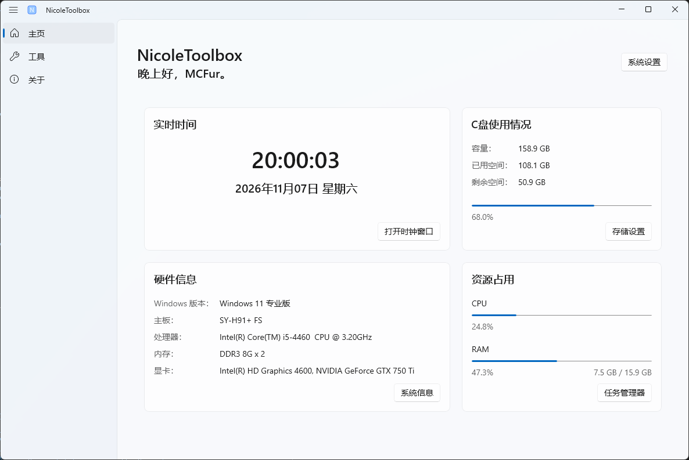

# NicoleToolbox

简体中文 | [English](./README_en.md)
### 基于 WinUI3 制作的简单工具箱，打开即是实用主页，并内置一些实用小工具

  

## 安装
在这个页面下载：[Releases](https://github.com/MCFurina/NicoleToolbox/releases/)

## 请安装以下运行时
.NET Desktop Runtime 10.0.14 [下载](https://builds.dotnet.microsoft.com/dotnet/WindowsDesktop/10.0.14/windowsdesktop-runtime-10.0.14-win-x64.exe)  
Windows APP Runtime 2.6.5 [下载](https://aka.ms/windowsappsdk/2.6/2.6.5/windowsappruntimeinstall-x64.exe)  

## 已支持语言

## 贡献者

