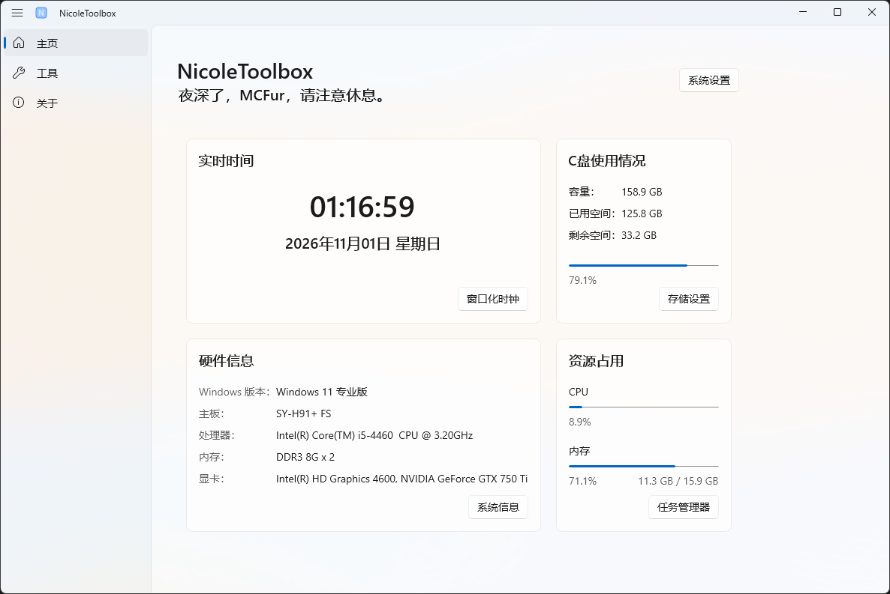

# NicoleToolbox

### 基于 WinUI3 制作的简单工具箱，打开即是实用主页，并内置一些实用小工具

## 运行前请安装以下运行库
.NET 桌面运行时 10.0.14 [下载](https://builds.dotnet.microsoft.com/dotnet/WindowsDesktop/10.0.14/windowsdesktop-runtime-10.0.14-win-x64.exe)  
Windows APP SDK 2.6.4 [下载](https://aka.ms/windowsappsdk/2.6/2.6.4/windowsappruntimeinstall-x64.exe)  

## 贡献者

