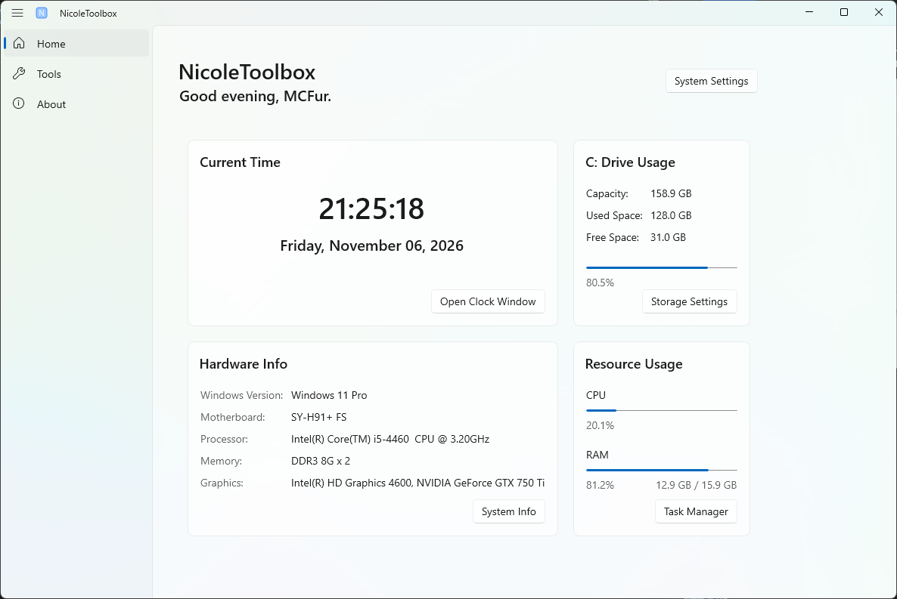

# NicoleToolbox

[简体中文](./README.md) | English
### A simple toolbox built with WinUI 3. It opens directly to a practical home page and includes a set of handy built-in tools.

## Install
Download from this page: [Releases](https://github.com/MCFurina/NicoleToolbox/releases/)

## Please install these runtimes
.NET Desktop Runtime 10.0.14 [Download](https://builds.dotnet.microsoft.com/dotnet/WindowsDesktop/10.0.14/windowsdesktop-runtime-10.0.14-win-x64.exe)  
Windows APP Runtime 2.6.5 [Download](https://aka.ms/windowsappsdk/2.6/2.6.5/windowsappruntimeinstall-x64.exe)  

## Contributors

